<div align="center">

# AFET ATLAS

### Türkiye Bölgesel Analiz ve Karar Destek Platformu

**BBY261 İleri Programlama · Python · Streamlit · Google ADK / Gemini**

Türkiye'nin 81 ilini ve 973 ilçesini; doğal afet göstergeleri, yaşam koşulları ve sektörel ticari potansiyel açısından aynı etkileşimli harita üzerinde incelemeyi amaçlayan veri odaklı bir uygulama.

[**Canlı uygulamayı aç**](https://afetatlas.streamlit.app/) · [**Kaynak kodu görüntüle**](https://github.com/utkuerekinci/afet-atlas)

</div>

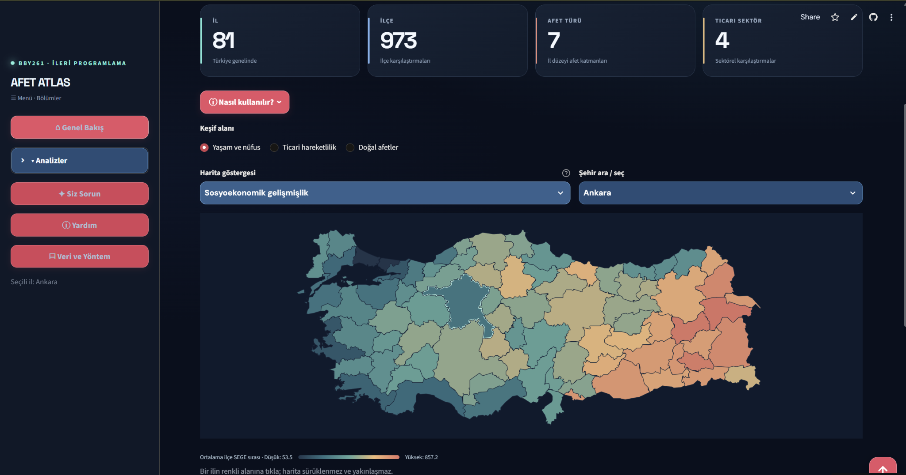

> **Kapsam notu:** Afet Atlas bir keşif ve karşılaştırma aracıdır. Ekranda yer alan güvenlik, yaşam tercihi ve ticari fırsat puanları uygulamanın veri kapsamı ve ağırlıklarına dayanan **göreli endekslerdir**. Gelecekteki afetlerin olasılığını, bir ilçedeki bireysel yaşam memnuniyetini veya bir yatırımın getirisini ölçmez.

---

## Proje özeti

| Kapsam | Uygulamadaki karşılığı |
| :--- | :--- |
| **81 il** | İl sınırları, il seçimi ve il düzeyi tematik haritalar |
| **973 ilçe** | Nüfus, SEGE ve uygun göstergelerle ilçe sıralaması ve karşılaştırma |
| **7 afet başlığı** | Deprem, orman yangını, sel/taşkın, heyelan, çığ, fırtına ve kuraklık |
| **4 ticari sektör** | Yeme-içme, market/perakende, hizmetler, lojistik/depolama |
| **Yapay zekâ** | Google ADK araçlarını kullanan *Siz Sorun* asistanı ve Gemini destekli yorumlar |
| **Veri yönetimi** | Yetkili giriş, CSV/JSON doğrulaması, ayrı özel GitHub veri deposuna yayınlama ve sürüm geçmişi |

Uygulama üç ana soruyu birlikte ele alır: **Bir ilde hangi göstergeler öne çıkıyor?** **İlçeler hangi tercihlere göre sıralanıyor?** **Bu sonuçların arkasında hangi veri ve model ağırlıkları var?** Genel Bakış sayfası bütünleşik bir giriş sunarken ayrıntılı bölümler her analizin filtrelerini ve gerekçelerini ayrı gösterir.

## Uygulama bölümleri

### 1. Genel Bakış: Üç farklı katmanda Türkiye haritası

**Genel Bakış**, aynı 81 il haritasını üç farklı amaçla kullanır:

- **Yaşam ve nüfus:** Nüfus (2025), ilçe sayısı ve ortalama ilçe SEGE sırası gibi göstergeler.
- **Ticari hareketlilik:** İl bazında ticari ön inceleme puanlarının harita üzerinde karşılaştırılması.
- **Doğal afetler:** Yedi afet bileşeninden oluşturulmuş proje güvenlik endeksinin il bazında karşılaştırılması.

Haritadaki iller seçilebilir. Seçilen il için kısa bir özet ve ilgili analiz sayfasına yönlendirme bulunur. Sayfanın sağ altındaki kırmızı kaydırma düğmesi sayfa konumuna göre aşağı/yukarı yön değiştirir.

| Ticari hareketlilik | Doğal afetler |
| :---: | :---: |
| 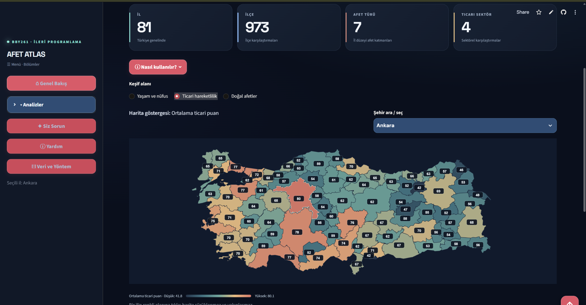 | 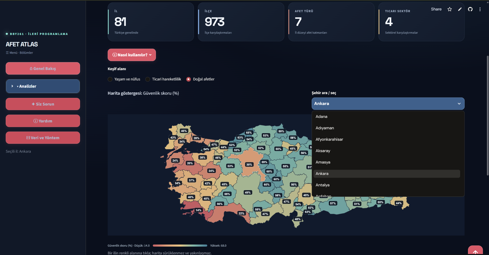 |

> Haritada gösterilen **“Güvenlik skoru (%)”**, afet yaşanma olasılığı değildir. Geçmiş kayıtların normalize edilip ağırlıklandırılmasıyla elde edilen karşılaştırmalı model değeridir. Yüksek puan, seçilen modelde daha düşük kayıtlı faaliyet düzeyini ifade eder.

### 2. Afet Analizi: Yedi farklı veri katmanı

**Afet Analizi** bölümünde deprem için başlangıç/bitiş yılı, minimum büyüklük, il sınırına yakınlık ve incelenecek il seçilebilir. Harita; il eşleşmeleri, olay puanları, sıralamalar ve ilgili kayıtları gösterebilir.

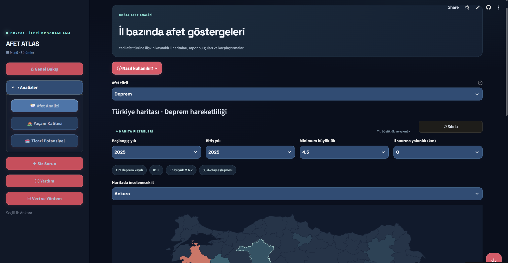

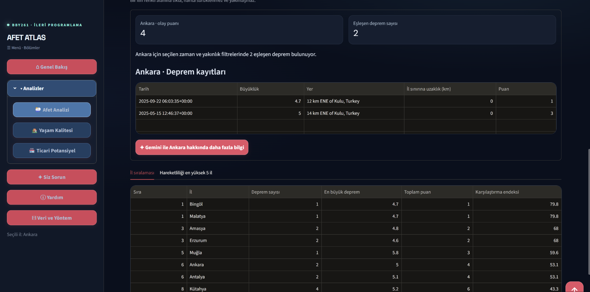

Deprem dışındaki altı katman aynı kapsamda **eşit ayrıntıya sahip değildir**. Uygulama, elde bulunan veri ve rapor türünü birbirinden ayırır:

| Afet | Mevcut yaklaşım ve sınır |
| :--- | :--- |
| **Deprem** | USGS olay kayıtları; koordinat, büyüklük, tarih ve il sınırına yakınlığa dayalı eşleştirme. |
| **Orman yangını** | 2024 ve 2025 için il düzeyinde yangın sayısı/yanan alan kayıtları; kullanılan tablolar **ikincil aktarım** niteliğindedir, resmî Excel satırlarıyla tam doğrulanmış olarak sunulmaz. |
| **Sel / taşkın** | MGM 2024 raporunda belirtilen ulusal bulgular ve adı geçen iller; her il için tam olay sayısı tablosu değildir. |
| **Heyelan** | MGM 2024 değerlendirmesinde bildirilen bulgular ve öne çıkan iller. |
| **Çığ** | MGM 2024 raporundaki sınıflar/aralıklar; aralıklar kesin sayıya dönüştürülmez. |
| **Fırtına** | MGM 2024 raporundaki ulusal bulgular ve raporda öne çıkan iller. |
| **Kuraklık** | MGM 2024 iklim raporunun yedi coğrafi bölgeye ilişkin yağış sapması; il düzeyinde bağımsız SPI ölçümü değildir. |

Bir ilin raporda yer almaması, o ilde **sıfır afet yaşandığı** anlamına gelmez. Katmanlara göre eksik gözlemler ayrı değerlendirilir.

<details>
<summary><strong>Gelişimden örnek: orman yangını ve sel/taşkın katmanları</strong></summary>


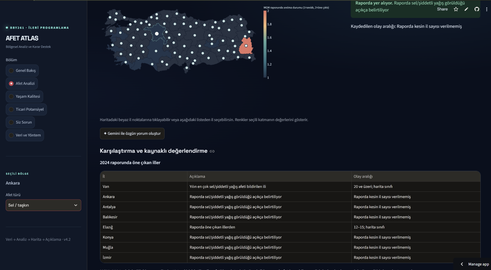

</details>

### 3. Yaşam Kalitesi: Tercihe göre ilçe karşılaştırması

Yaşam Kalitesi bölümü, **2025 ilçe nüfusu** ile **2022 İlçe SEGE sıralamasını** temel alan bölgesel göstergeleri birleştirir. Mevcut veri kapsamı elverdiğinde ulaşım kayıtları da değerlendirmeye katılır.

Kullanıcı **Dengeli**, **Daha sakin** veya **Daha hareketli** yaşam tercihlerinden birini seçebilir. Ardından hem Türkiye genelindeki hem de seçilen ilin ilçeleri arasındaki sıralamaları inceleyebilir. **“Neden Bu İlçe Birinci?”** bölümünde birincinin puanı, alternatif ilçeyle farkı ve kullanılan göstergelerin ağırlıkları açıklanır. **İki ilçeyi karşılaştır** alanı, iki ilçeyi aynı kapsamda değerlendirmeye imkân verir.

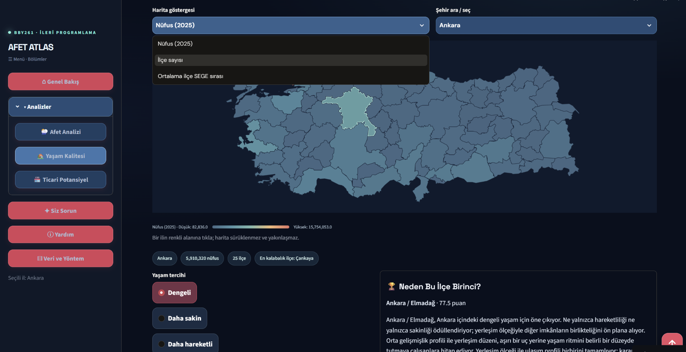

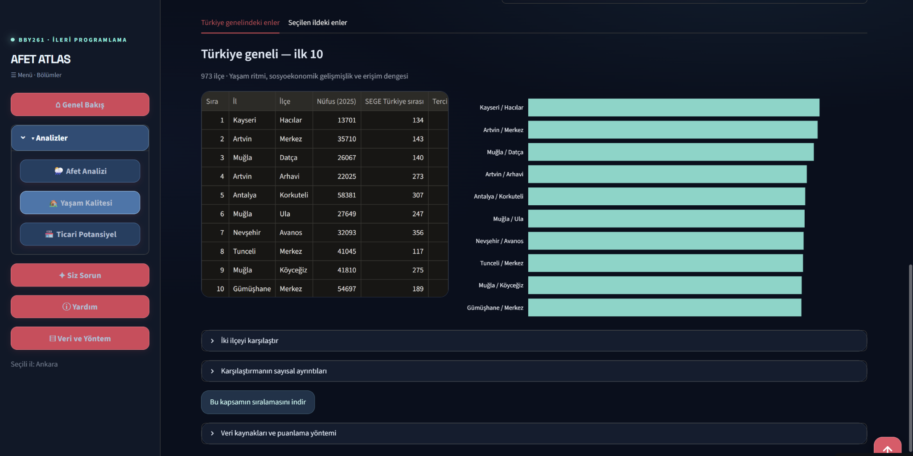

**Modelin sınırı:** Tercih uyumu puanı, 2025 yılında yapılmış bireysel memnuniyet araştırması değildir. SEGE-2022 de kendi yayım döneminin sosyoekonomik profilini yansıtır; 2025'in doğrudan ölçümü olarak değerlendirilmez.

### 4. Ticari Potansiyel: Dört sektör için ön değerlendirme

Ticari Potansiyel bölümü dört sektör için ayrı karşılaştırma sunar: **Yeme-içme**, **Market / perakende**, **Hizmetler** ve **Lojistik / depolama**. Sektöre göre nüfus, yaklaşık yoğunluk, SEGE, OSM işletme kayıtları ve uygun durumlarda ulaşım göstergeleri birlikte değerlendirilir. Yeterli ve karşılaştırılabilir veri yoksa ilgili bileşen puandan çıkarılır ve kullanılan ağırlıklar yeniden düzenlenir.

**Harita göstergesi** üzerinden *Sektörel fırsat puanı* veya *İlçe sayısı* seçildiğinde ilgili değerler illerin üzerinde yazılır. Sıralama, gerekçeli ilçe açıklamaları, iki ilçe karşılaştırması ve OSM işletme/ulaşım kayıtlarını inceleme bölümleri bulunur.

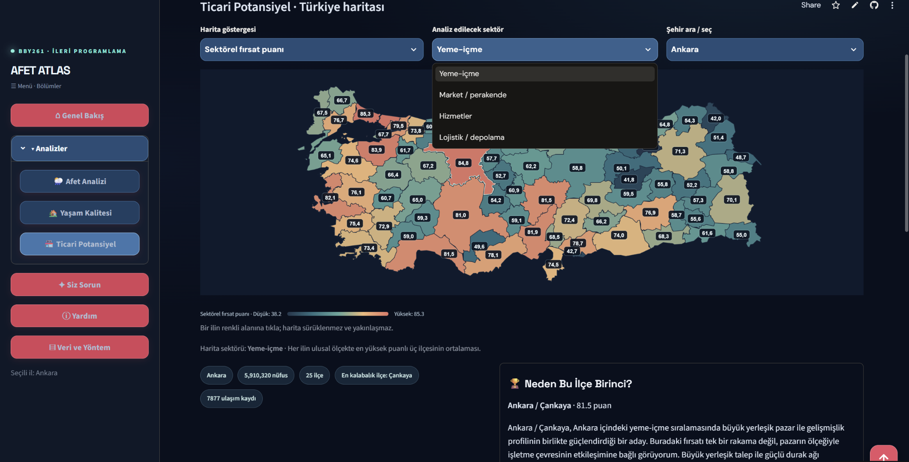

OSM tablosu **resmî işyeri sicili değildir**. OSM işletme sayıları gerçek müşteri trafiği, ulaşım durak sayıları yaya akışı ve modelin fırsat puanı da kâr/ciro tahmini olarak yorumlanmamalıdır. Kira verisi, ortak karşılaştırma için yeterli kapsama sahip olmadığında puana katılmaz.

### 5. Siz Sorun: Google ADK ve Gemini

**Siz Sorun** ekranında hazır örnek sorulardan biri seçilebilir veya kullanıcı kendi sorusunu yazabilir. Google **Agent Development Kit (ADK)** ajanı, sorunun türüne göre uygulamanın Python veri araçlarını kullanarak deprem, nüfus, ilçe sıralamaları, afet kaynakları ve ticari göstergeler hakkında yanıt üretmek üzere tasarlanmıştır. Sayısal hesaplamalar araçlara dayanır; Gemini bu sonuçları doğal dilde açıklar.

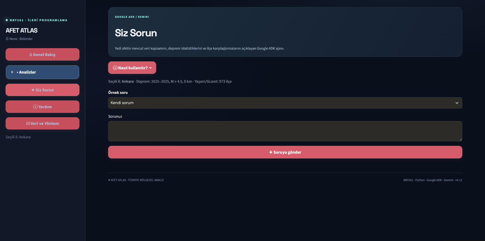

<details>
<summary><strong>Örnek soru menüsü</strong></summary>

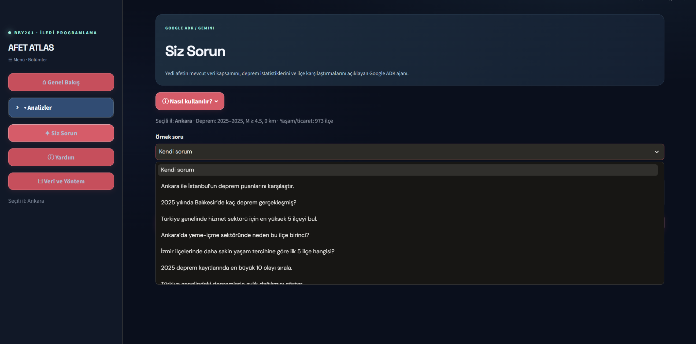

</details>

Ayrıca uygun analiz ekranlarında **Gemini ile özgün yorum oluştur** seçeneği yer alır. Geçici sunucu yoğunluğu hataları için sınırlı yeniden deneme ve alternatif model mekanizması kodda bulunmaktadır. Bunun çalışması, Google API erişimi ve kullanılan modelin kullanılabilir olmasına bağlıdır. Temel haritalar ve Python hesaplamaları yapay zekâ yanıtından ayrı çalışır.

### 6. Yardım, Veri ve Yöntem

**Yardım** sayfası haritadan il seçme, analizlere geçme, karşılaştırma yapma ve yapay zekâ araçlarını kullanma adımlarını açıklar. Kaynak kod deposuna bağlantı içerir. **Veri ve Yöntem** sayfası ise veri kaynaklarını, kapsam sınırlarını ve puanlama yaklaşımını açıklar.

| Kullanım rehberi | Veri ve yöntem |
| :---: | :---: |
| 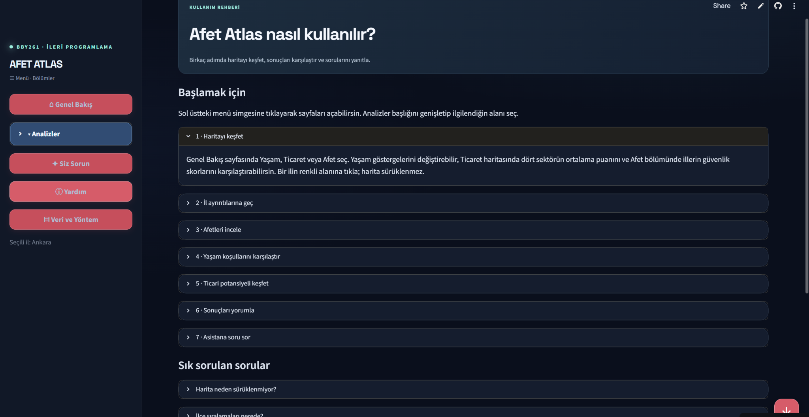 | 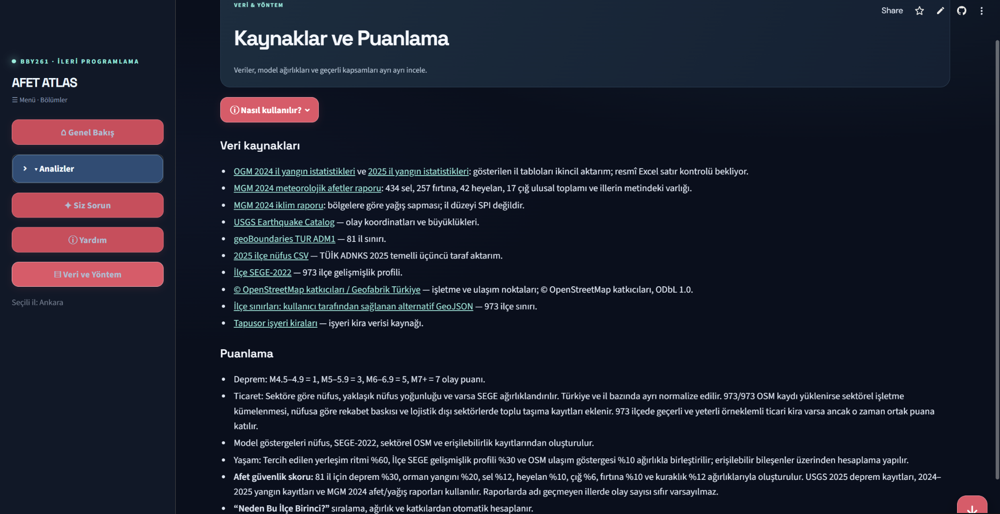 |

### 7. Yetkili yönetici paneli

Yönetici girişine, **Genel Bakış sayfasının en altındaki küçük kilit simgesinden** ulaşılır. Bu konum yalnızca arayüz tercihidir; yönetim yetkisi kilidin konumuna değil **kullanıcı adı ve parola doğrulamasına** bağlıdır.

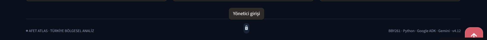

Yönetici panelinde şu iş akışı bulunur:

1. Yalnızca yetkili kullanıcı adı ve parola ile oturum açılır. Parola doğrulamasında **Argon2id** özeti kullanılır.
2. Yönetilebilir veri seti seçilir, uygun **CSV/JSON** dosyası yüklenir.
3. Dosya biçimi ve içerik kuralları denetlenir; açıklama/commit notu girilir.
4. Doğrulanan veri, yetkili bağlantı mevcutsa **ayrı özel GitHub veri deposuna** yayımlanır.
5. Veri setlerinin durumu ve GitHub sürüm geçmişi incelenebilir; uygun sürüme geri dönme işlemleri panelden yapılabilir.

| Yetkili giriş ekranı | Veri yükleme ve doğrulama |
| :---: | :---: |
| 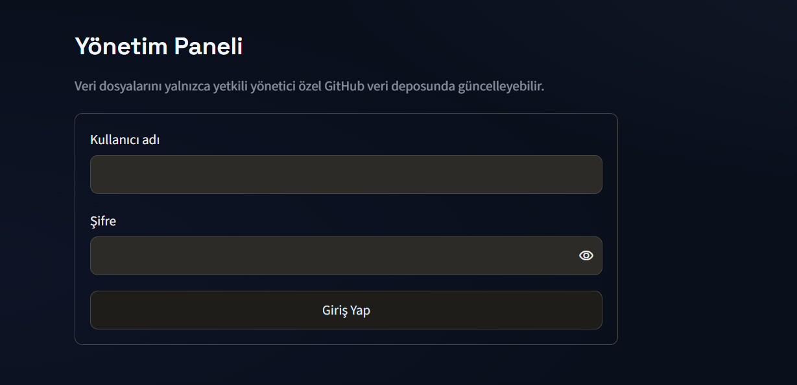 | 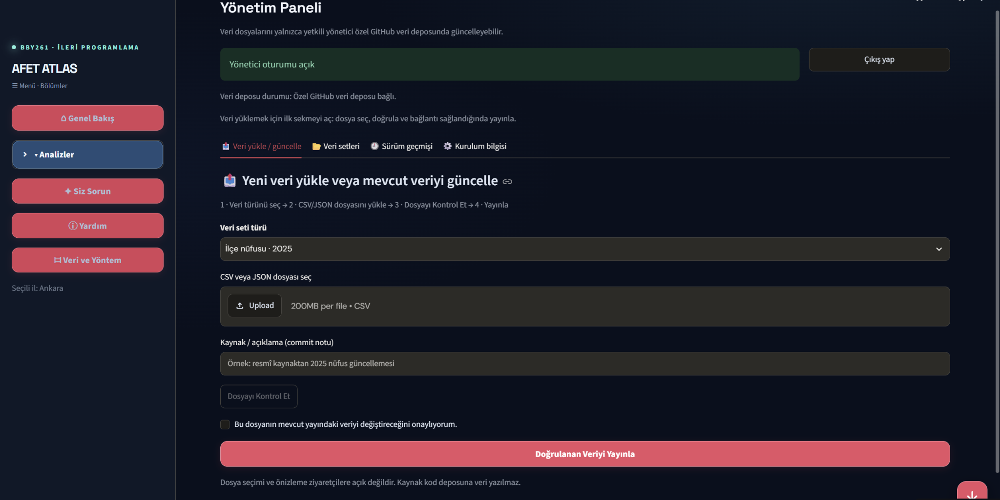 |

**Depo ayrımı:** [Herkese açık kod deposu](https://github.com/utkuerekinci/afet-atlas) ile yönetilen **özel veri deposu** birbirinden bağımsızdır. GitHub erişim tokenı, yönetici parolası ve Gemini API anahtarı kaynak kod deposunda yayımlanmaz; sunucu tarafında Streamlit Secrets üzerinden yapılandırılır. Bağlantı başarısızsa dosya inceleme arayüzü açılabilir, ancak veri yayımlama yetki doğrulanana kadar kapalı kalır.

---

## Veriler, dönemler ve puanlama

Farklı veri kaynakları aynı takvim yılını ölçmez. Uygulama bu nedenle kaynağın **türünü, tarihini ve kapsamını** analizden ayırarak sunmayı amaçlar.

| Veri grubu | Dönem | Kullanım | Kaynak / açıklama |
| :--- | :--- | :--- | :--- |
| Deprem olay kataloğu | Yerel paket: **2025**; arayüz filtreleri kapsama bağlı | Büyüklük, tarih ve konumsal eşleştirme | [USGS Earthquake Catalog](https://earthquake.usgs.gov/earthquakes/search/) |
| İl sınırları | Veri dosyasının sürümü | 81 ilin GeoJSON poligonları | [geoBoundaries](https://www.geoboundaries.org/) / TUR ADM1 |
| İlçe nüfusu | **2025** | 973 ilçenin nüfus ve yaklaşık yoğunluk alanları | TÜİK ADNKS temelli, [topografya/veri](https://github.com/topografya/veri) üzerinden işlenen aktarım |
| İlçe SEGE | **2022** | İlçe sosyoekonomik gelişmişlik sırası ve modeli | [Sanayi ve Teknoloji Bakanlığı SEGE](https://www.sanayi.gov.tr/bolgesel-kalkinma-faaliyetleri/analitik-calismalar/01161b) |
| İşletme / ulaşım | Paketli OSM özeti | İlçe düzeyi işletme etiketi ve durak/istasyon kayıtları | [OpenStreetMap](https://www.openstreetmap.org/) / [Geofabrik](https://download.geofabrik.de/) temelli özet |
| Orman yangını | **2024–2025** | İl düzeyinde yangın ve yanan alan göstergeleri | OGM kaynaklarına dayalı **ikincil tablolar**; resmî satır düzeyi doğrulama sınırı mevcut |
| Sel, heyelan, çığ, fırtına | **2024** | MGM raporunda bildirilen özetler ve öne çıkan iller | [MGM 2024 Meteorolojik Afetler Değerlendirmesi](https://www.mgm.gov.tr/FILES/genel/raporlar/2024%20MetAfet%20Degerlendirme%20Raporu_V1.pdf) |
| Kuraklık | **2024** | 7 coğrafi bölgenin yağış sapmasının haritada gösterimi | [MGM 2024 İklim Raporu](https://www.mgm.gov.tr/FILES/iklim/yillikiklim/2024-iklim-raporu.pdf) |

### Endeks mantığı

**Afet güvenlik endeksi** uygulamada 0–100 aralığında gösterilir. Modeldeki ağırlıklar: deprem **%30**, orman yangını **%20**, sel/taşkın **%12**, heyelan **%10**, çığ **%6**, fırtına **%10**, kuraklık **%12**. Kullanılan kaynaklar normalize edilerek birleştirilir; raporda bulunmayan il kayıtları otomatik olarak sıfır olay kabul edilmez. Bu puan **bilimsel afet güvenliği olasılığı değildir**.

**Yaşam tercihi endeksi** için hedeflenen temel bileşenler yerleşim ritmi **%60**, SEGE **%30** ve ulaşım **%10** olarak tanımlanmıştır. Veri olmayan bileşenin ağırlığı, kullanılabilir göstergeler arasında yeniden paylaştırılır. Dengeli/sakin/hareketli tercihi yerleşim ritmi bileşeninin yorumunu değiştirir.

**Ticari fırsat endeksi**, sektöre göre değişen nüfus, yoğunluk, SEGE, işletme kümelenmesi, işletme/nüfus oranından türetilen rekabet baskısı, ulaşım ve yalnızca yeterli ulusal kapsama sahip olduğunda kira bileşenlerinin ağırlıklı sıralamasıdır. Eksik bir alanın puanı keyfî biçimde sıfır yapılmaz. Ağırlıklar **proje modeline ait varsayımlardır**; gerçekleşmiş kâr veya yatırım performansıyla kalibre edildiği iddia edilmez.

İlçe sonuçları Türkiye çapında ya da seçilen il sınırlarında yeniden hesaplanabilir. Birincilik açıklamaları, puanı oluşturan katkılarla ve ikinci sıradaki alternatifle birlikte değerlendirilir.

---

## Teknik mimari

Uygulama **Python / Streamlit** ile geliştirilmiştir. **pandas** veri tabloları, **shapely / pyproj** mekânsal işlemler, **Plotly** grafikler, **Folium / Leaflet** sabit etkileşimli harita, **Google ADK ve Gemini** veri odaklı doğal dil yorumları için kullanılmaktadır. Yönetici veri güncellemelerinde **GitHub REST API** ve parola doğrulamasında **Argon2id** bulunur.

```text
afet-atlas/
├── app.py                    # Streamlit giriş noktası, menü ve sayfalar
├── atlas_ui.py               # Yaşam / Ticaret modülleri
├── atlas_afet_ui.py          # Deprem dışı afet ekranları
├── atlas_harita.py           # Harita veri/çizim yardımcıları
├── atlas_sabit_harita.py     # İl tıklamalı sabit Türkiye haritası
├── bolge_puanlari.py        # Yaşam ve ticaret endeksleri
├── hesaplama.py              # Deprem hesaplama mantığı
├── atlas_gemini_yorum.py     # Gemini yorum çağrıları
├── atlas_gemini_dayaniklilik.py # Geçici API hatalarında yeniden deneme
├── atlas_yonetim_ui.py      # Yönetici oturumu ve veri yükleme arayüzü
├── atlas_yonetim_depo.py    # Özel GitHub veri deposuyla işlemler
├── atlas_kaydirma.py        # Sayfa içi kaydırma düğmesi
├── afet_atlas_adk/
│   ├── agent.py              # ADK ajanı ve yönergeleri
│   ├── calistir.py           # Ajanı çalıştırma yolu
│   ├── veri_araclari.py      # Deprem veri araçları
│   ├── bolge_araclari.py     # İlçe / yaşam / ticaret araçları
│   ├── diger_afet_araclari.py # Diğer afetlere ilişkin araçlar
│   └── kapsam_araclari.py    # Veri kapsamı ve yöntem araçları
├── indirilen_veriler/       # Paketli veri dosyaları ve manifestler
├── docs/screenshots/        # Gerçek uygulama ekran görüntüleri
├── requirements.txt
└── README.md
```

### İşleyiş

```text
Veri dosyaları / özel veri deposu
              │
              ▼
     Python okuma ve doğrulama
              │
              ▼
  Hesaplama + göreli endeks modelleri
              │
      ┌───────┴────────┐
      ▼                ▼
 Streamlit arayüzü   Google ADK araçları
 Harita / tablolar         │
      │                    ▼
      │               Gemini yanıtı
      └─────────┬──────────┘
                ▼
         Kullanıcıya sunum
```

Modelin hesaplamayı gerçekleştiren koduyla doğal dilde yorum üreten yapay zekâ bileşeni birbirinden ayrıdır. Yapay zekâ için ağ ve uygun API anahtarı gerekir; kaynaklı istatistiklerin kendisi Python modüllerinde hesaplanır.

## Yerel kurulum

### Gereksinimler

- Python 3.11 veya uyumlu bir güncel Python 3 sürümü
- İnternet erişimi (dış veri indirme, Gemini ve GitHub işlemleri gerektiğinde)
- [requirements.txt](requirements.txt) dosyasındaki Python paketleri

```bash
# Kaynak kodu indir
# https://github.com/utkuerekinci/afet-atlas

# Proje klasöründe bağımlılıkları yükle
python -m pip install -r requirements.txt

# Uygulamayı çalıştır
python -m streamlit run app.py
```

Streamlit terminalde yerel adresi gösterir (çoğu kurulumda `http://localhost:8501`). Paketli verilerle çalışan harita ve temel analizler, Gemini isteği yapılmadan da incelenebilir.

### İsteğe bağlı yapay zekâ ve yönetici yapılandırması

Yerel ortam değişkenleri veya **Streamlit Secrets** üzerinden aşağıdaki ayarlar tanımlanabilir. **Gerçek değerler asla repoya veya ekran görüntülerine eklenmemelidir.**

| Gizli ayar | Görev |
| :--- | :--- |
| `GOOGLE_API_KEY` | Gemini / ADK API erişimi |
| `AFET_ATLAS_MODEL` | Kullanılacak birincil Gemini modeli (hesapta erişilebilir model olmalı) |
| `AFET_ATLAS_YEDEK_MODEL` | İsteğe bağlı yedek model |
| `AFET_ATLAS_ADMIN_KULLANICI` | Tek yetkili yönetici kullanıcı adı |
| `AFET_ATLAS_ADMIN_SIFRE_OZETI` | Argon2id biçiminde parola özeti |
| `AFET_ATLAS_VERI_REPOSU` | Ayrı özel GitHub veri deposunun `sahip/depo` adı |
| `AFET_ATLAS_VERI_DALI` | Özel veri deposunda kullanılan dal |
| `AFET_ATLAS_VERI_TOKEN` | Yalnızca özel veri deposuna erişebilen fine-grained GitHub tokenı |

Yönetici parolasının özetini üretme ve GitHub erişim izinlerini hazırlama adımları için [YONETICI_KURULUM.md](YONETICI_KURULUM.md) dosyası kullanılabilir. Özel depoya erişim yetkisi, uygulamanın kod deposuna erişim yetkisinden ayrı yönetilir.

### Testler

```bash
python -m unittest discover -v
```

Testler veri eşleştirme, puanlama, harita ve çeşitli uygulama bileşenlerini kapsayan birim kontroller içerir. Gerçek **Gemini yanıtı**, canlı harita tıklamaları ve GitHub özel depo yetkileri ayrıca çalışan ortamda doğrulanmalıdır.

---

## Geliştirme süreci

Afet Atlas, tek bir deprem karşılaştırma ekranından başlayıp çok kaynaklı bölgesel analiz platformuna dönüştü. Aşağıdaki kronoloji, proje dosyaları ve **gerçek sürüm ekran görüntüleri** üzerinden hazırlanmıştır; erken aşamadaki tamamlanmamış modüller güncel sistemin özellikleriymiş gibi değerlendirilmemelidir.

| Aşama | Gelişme |
| :--- | :--- |
| **İlk prototip** | USGS deprem kayıtları, yıl/büyüklük/yakınlık filtreleri, ilk il karşılaştırması. İlk ekran görüntüsünde harita alanı henüz tamamlanmış görünmüyor. |
| **v2.x** | Deprem haritasının ve il sıralamalarının geliştirilmesi; Google ADK ile ilk *Siz Sorun* ekranı. |
| **v3.0** | Çoklu afet için ilk arayüz taslağı. Taslakta sekiz afet konusu yer alırken güncel modelde yedi başlık değerlendiriliyor. |
| **v3.2** | İlçe bazında yaşam ve ticaret ön analizlerinin eklenmesi. |
| **v3.4–v3.5** | Ortak Türkiye haritası, il/ilçe karşılaştırmaları ve gerekçeli sıralama açıklamaları. |
| **v3.5.4–v3.8** | 973 ilçenin nüfus–SEGE eşleştirmesi, afet katmanları ve ilçe ölçeğinde OSM işletme/ulaşım verilerinin eklenmesi. |
| **v4.0–v4.2** | Üç temalı Genel Bakış, yenilenen açıklamalar ve Gemini yorumlarının geliştirilmesi. |
| **v4.3–v4.12** | Sayfa düzeni, Yardım, sabit il haritası, yedi afetli birleşik endeks ve yönetici paneli çalışmalarının olgunlaştırılması. |
| **v4.13–v4.20.x** | Koyu tema, filtre davranışı, ticari harita değer etiketleri, geçici Gemini hata yönetimi, sağ alt kaydırma düğmesi ve alt bilgi kilidiyle yönetici girişinin son düzeni. |

<details>
<summary><strong>Gelişim aşamalarının ekran görüntülerini aç</strong></summary>

#### İlk deprem prototipi

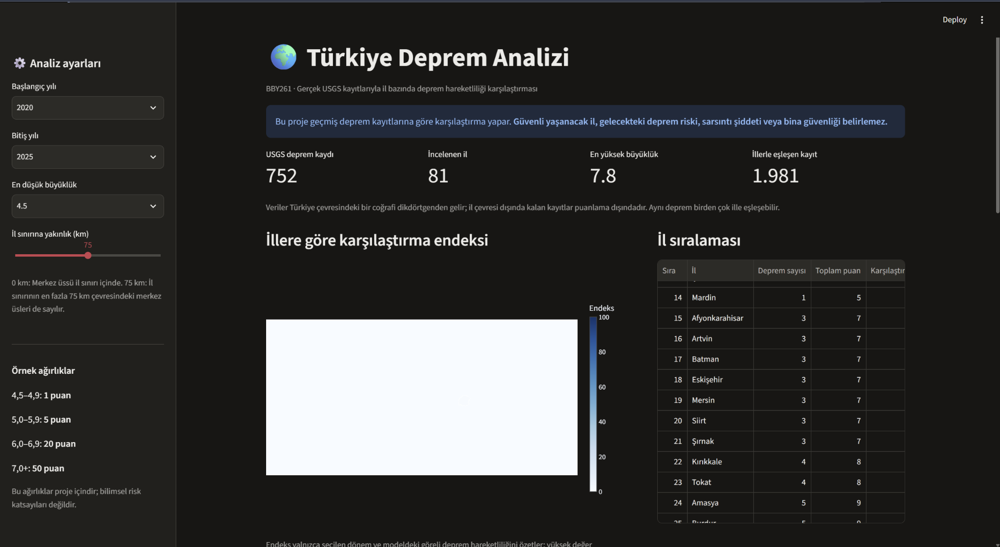

#### v2.6 — Deprem analizi ve ilk ADK asistanı

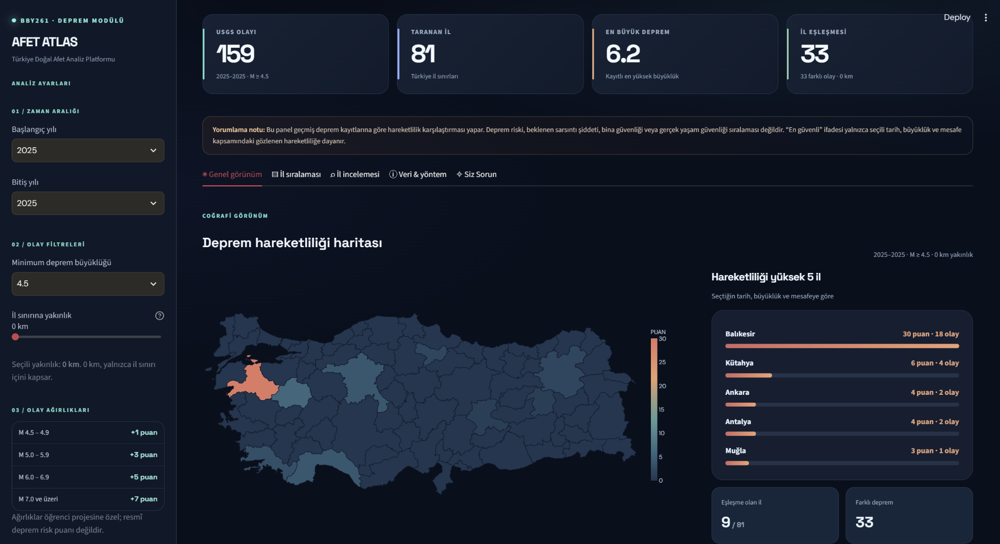

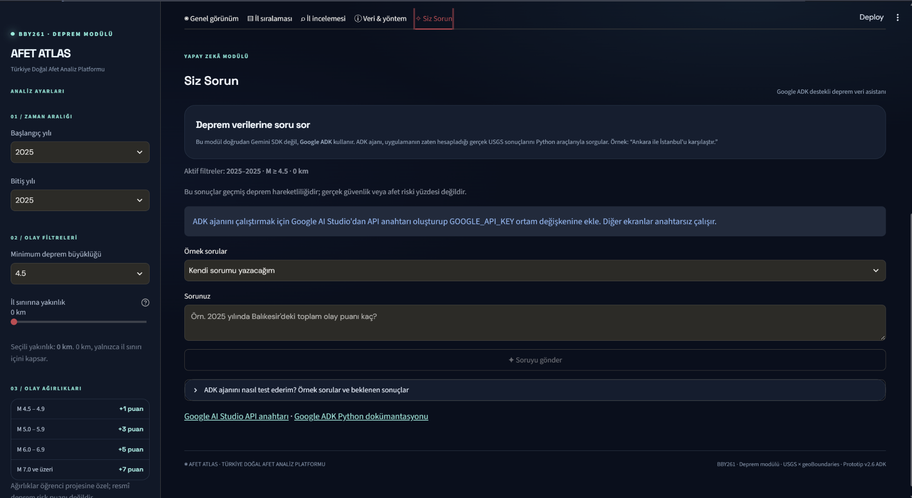

#### v3.0–v3.2 — Çoklu afet ve ilçe modülleri

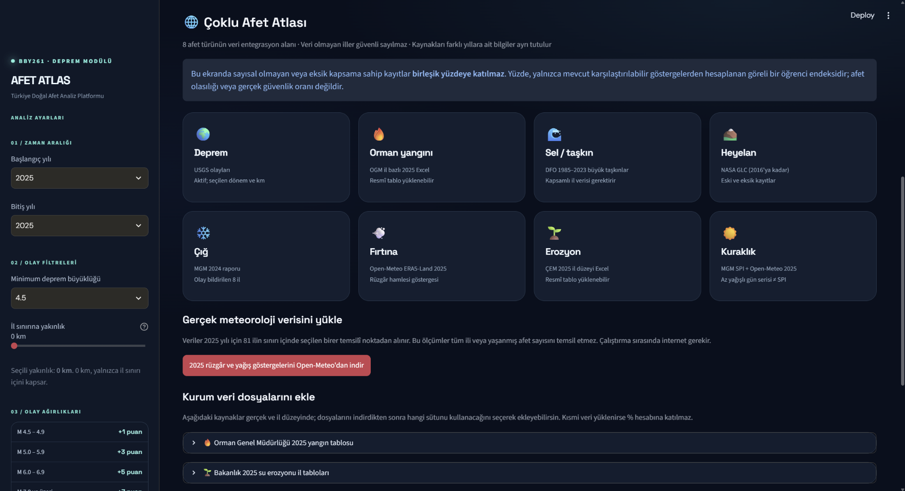

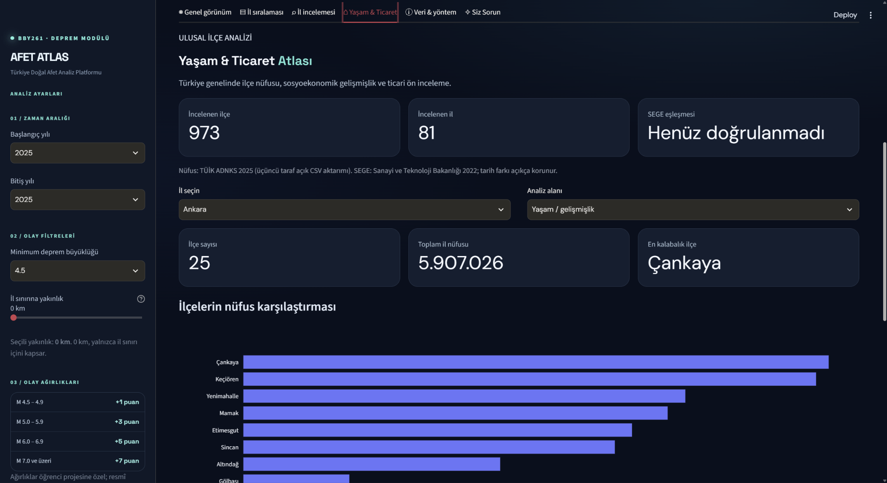

#### v3.5 — Ortak harita ve açıklanabilir sıralamalar

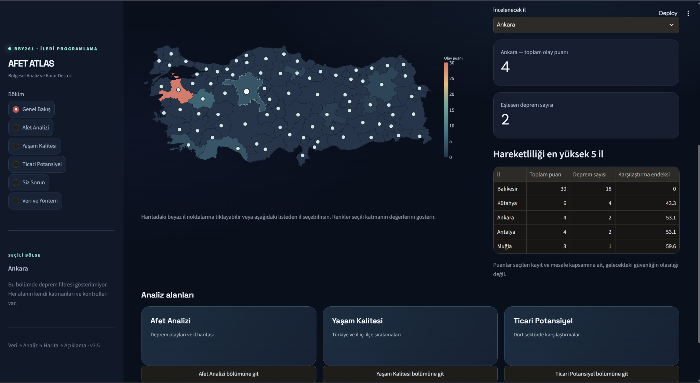

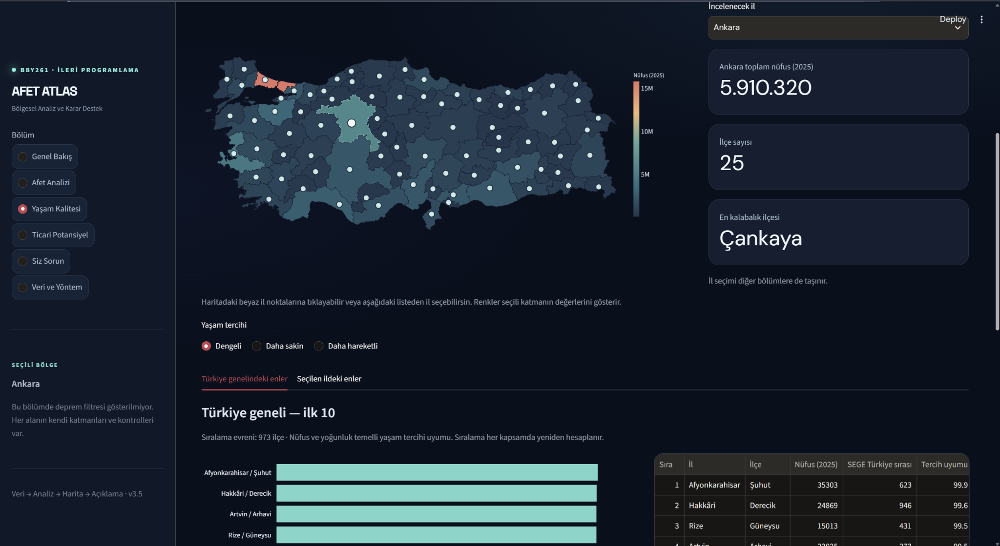

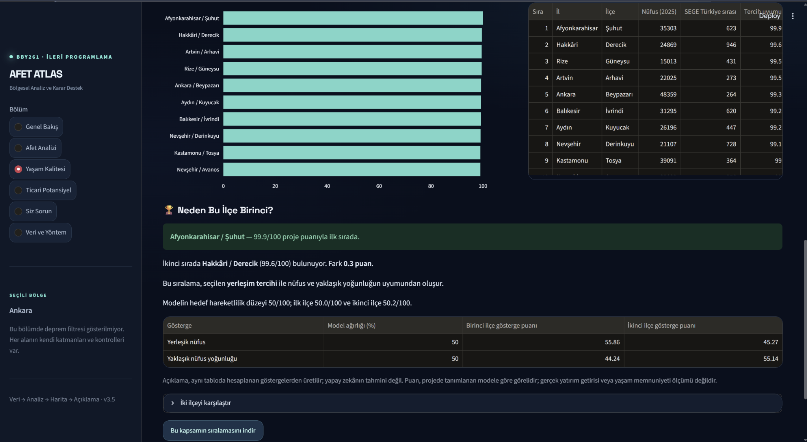

#### v3.6–v3.8 — Veri katmanlarının genişlemesi


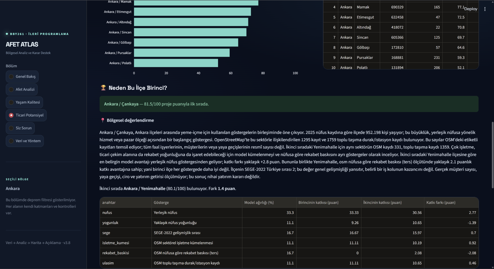

#### v4.2 — Gelişmiş Genel Bakış ve bölgesel açıklamalar

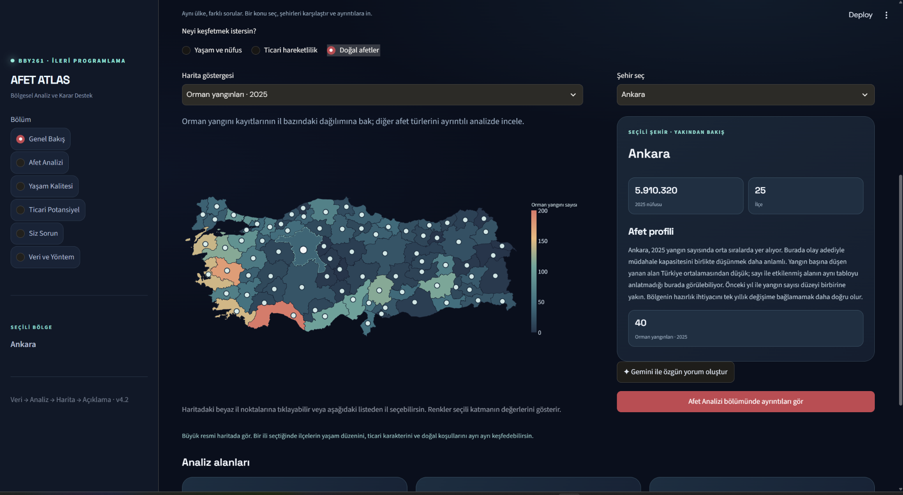

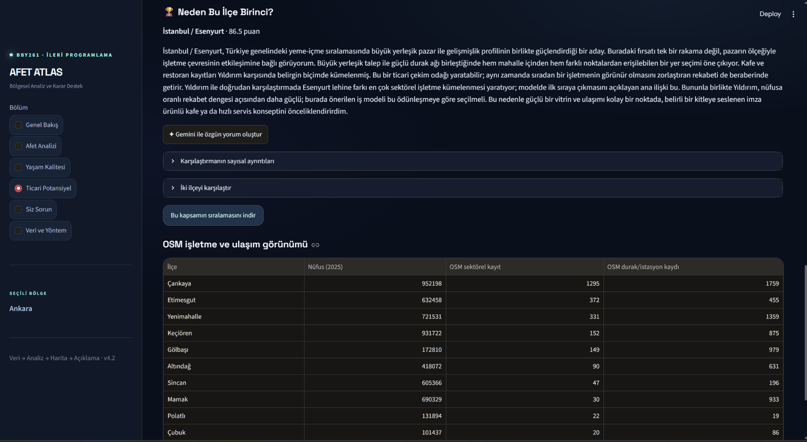

</details>

<details>
<summary><strong>Güncel arayüzden diğer ekran görüntülerini aç</strong></summary>

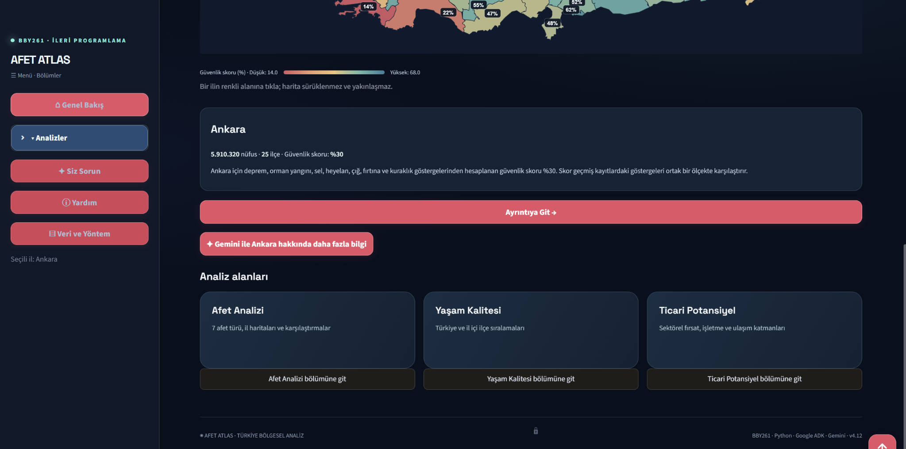

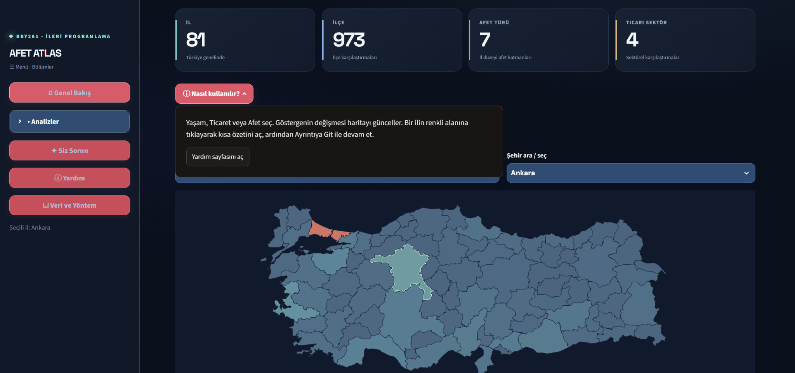

</details>

---

## Kapsam ve kullanım sınırları

Bu platformda bazı kaynaklar **olay kaydı**, bazıları **kurumsal rapor özeti**, bazıları **ilçe istatistiği** ve bazıları **OSM etiketi** niteliğindedir. Birbirine eşdeğer kabul edilmezler. Özellikle:

- Veri yılının farklı olması, farklı dönemlerin birlikte yorumlandığı anlamına gelir; tüm göstergeler aynı güne ait değildir.
- Deprem geçmişi veya ağırlıklı afet endeksi geleceğe yönelik deprem/risk tahmini olarak kullanılamaz.
- MGM metninde adı geçmeyen il için sıfır olay sonucuna varılamaz; çığ sınıfları kesin sayıya indirgenemez.
- İkincil orman yangını tablolarının doğrulama düzeyi resmî satır kontrolünden farklıdır.
- OSM kayıtları tüm işletmeleri kapsamayabilir; müşteri, kira, yaya veya ciro tahmini değildir.
- İlçe sıralamaları, seçilen tercihe, sektöre ve erişilebilir bileşenlere bağlıdır. Hesaplanan puanlar bilimsel olarak doğrulanmış güvenlik veya refah olasılıkları değildir.
- Google ADK / Gemini yanıtı yalnızca ilgili servis kullanılabilir ve API erişimi geçerliyken üretilebilir.

Bu sınırlar, analizlerin **kanıta dayalı bir ön inceleme** olarak kullanılmasını sağlar ve sonuçların kapsamı dışında kesin hükümler verilmesini önlemeye yardımcı olur.

---

<div align="center">

**Afet Atlas · BBY261 İleri Programlama**

[Canlı Uygulama](https://afetatlas.streamlit.app/) · [Kaynak Kod](https://github.com/utkuerekinci/afet-atlas) · [Yönetici Kurulumu](YONETICI_KURULUM.md)

</div>
