<div align="center">

# AFET ATLAS

### Türkiye Bölgesel Analiz ve Karar Destek Platformu

**Afetleri izle. Yaşam koşullarını karşılaştır. Ticari fırsatları keşfet.**

**BBY261 · İleri Programlama**  
`Python` · `Streamlit` · `Google ADK` · `Gemini` · `Plotly` · `OpenStreetMap`

**81 il** &nbsp;·&nbsp; **973 ilçe** &nbsp;·&nbsp; **7 afet türü** &nbsp;·&nbsp; **4 ticaret sektörü**

</div>

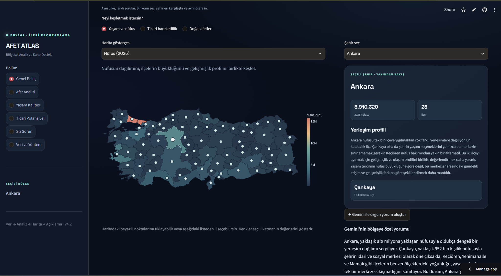

*Güncel Genel Bakış ekranı: ortak Türkiye haritası, konuya göre değişen il profili ve isteğe bağlı Gemini yorumları.*

## Proje hakkında

**Afet Atlas**, Türkiye'nin bölgesel verilerini tek bir uygulamada karşılaştırmak amacıyla geliştirilmiş bir **BBY261 İleri Programlama** projesidir. Çalışma, yalnızca deprem kayıtlarını haritada gösteren küçük bir prototip olarak başlamış; sonraki sürümlerde **çoklu afet analizi, yaşam kalitesi, ticari potansiyel, ilçe karşılaştırmaları ve yapay zekâ destekli yorumlama** özellikleri kazanmıştır.

Uygulama ile kullanıcılar bir il seçebilir, farklı veri katmanlarını Türkiye haritasında inceleyebilir, 973 ilçeyi ulusal veya il bazında karşılaştırabilir ve bir bölgenin neden öne çıktığını sayısal göstergeler ile yorumlar üzerinden değerlendirebilir.

### Güncel modüller

| Modül | Kullanıcı ne yapabilir? |
|---|---|
| **Genel Bakış** | Aynı Türkiye haritasında yaşam/nüfus, ticari hareketlilik ve afet görünümleri arasında geçiş yapabilir; il profillerini keşfedebilir. |
| **Afet Analizi** | Deprem, orman yangını, sel/taşkın, heyelan, çığ, fırtına ve kuraklık katmanlarını inceleyebilir. |
| **Yaşam Kalitesi** | 2025 nüfus, SEGE-2022 ve ulaşım göstergelerine dayanan yaşam tercihlerini Türkiye genelinde veya il içinde karşılaştırabilir. |
| **Ticari Potansiyel** | Yeme-içme, perakende, hizmet ve lojistik sektörlerinde ilçeleri; nüfus, gelişmişlik ve mevcut OSM kayıtlarıyla değerlendirebilir. |
| **Siz Sorun** | Google ADK destekli yapay zekâ asistanına proje verileriyle ilgili sorular sorabilir. |
| **Veri ve Yöntem** | Kullanılan kaynakları, kapsamı ve model ağırlıklarını inceleyebilir. |

---

## Proje nasıl gelişti?

Bu bölüm, eski ekran görüntülerini **sürüm sırasına göre** sunar. İlk tasarımlar, sonradan düzelttiğimiz eksiklikleri göstermek için bilerek korunmuştur.

### 1. Başlangıç — deprem prototipinden görsel analize

İlk sürümde odak yalnızca **USGS deprem kayıtlarını il bazında incelemekti**. Yıl, büyüklük ve il sınırına yakınlık gibi filtreler üzerinden bir karşılaştırma kurulmuştu. İlk çekimde harita alanı boş görünürken, sonraki tasarımda renkli Türkiye haritası, sıralama tablosu ve öne çıkan illerin gösterildiği daha bütünleşik bir ekran geliştirildi.

<table>
<tr><th>İlk deprem prototipi</th><th>Geliştirilmiş deprem arayüzü (v2.x)</th></tr>
<tr>
<td>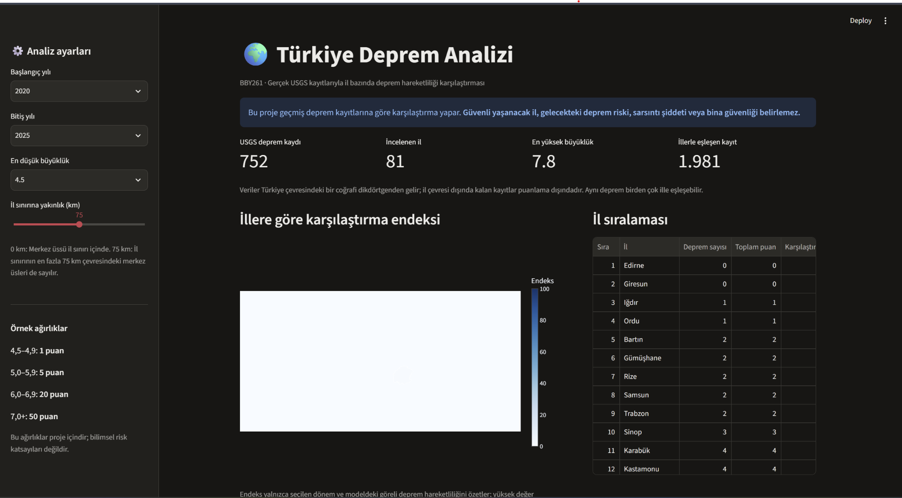</td>
<td>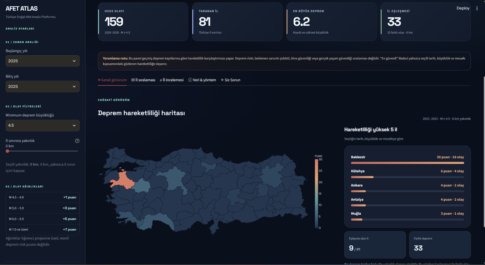</td>
</tr>
</table>

**Geliştirme:** Tablo ve filtre ağırlıklı ilk görünüm, harita merkezli bir veri keşif arayüzüne dönüştü.

### 2. İlk yapay zekâ denemesi — Google ADK ve “Siz Sorun” (v2.6)

Deprem verileri için kullanıcıların doğal dille soru sorabilmesini sağlayan **Siz Sorun** alanı eklendi. İlk aşamada araçlar ağırlıklı olarak deprem verileriyle sınırlıydı; daha sonraki sürümlerde yaşam, ticaret ve diğer afetlere ait araçlarla genişletildi.

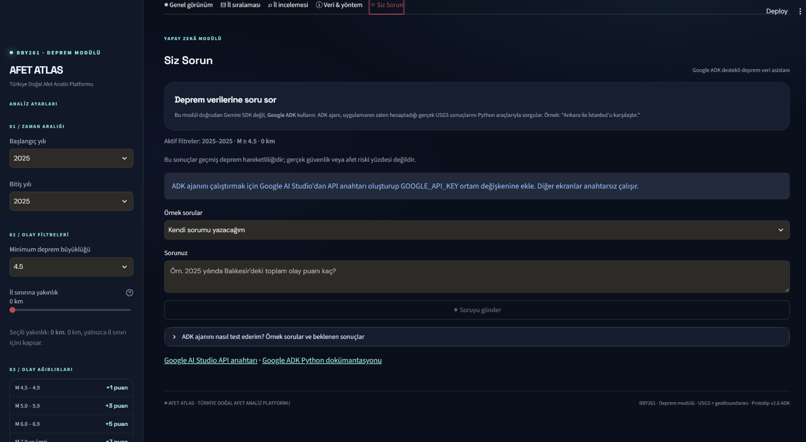

### 3. Tek afetten çoklu afete geçiş — ilk tasarım (v3.0)

Kapsamı depremle sınırlı tutmamak için **Çoklu Afet Atlası** ekranı oluşturuldu. Bu erken tasarımda deprem, yangın, sel, heyelan, çığ, fırtına, erozyon ve kuraklık için sekiz ayrı kart vardı. Ancak ekran hâlâ veri dosyası hazırlama ve kaynak yükleme adımlarına odaklanıyor, farklı afetleri ortak bir deneyimde yeterince sunamıyordu.

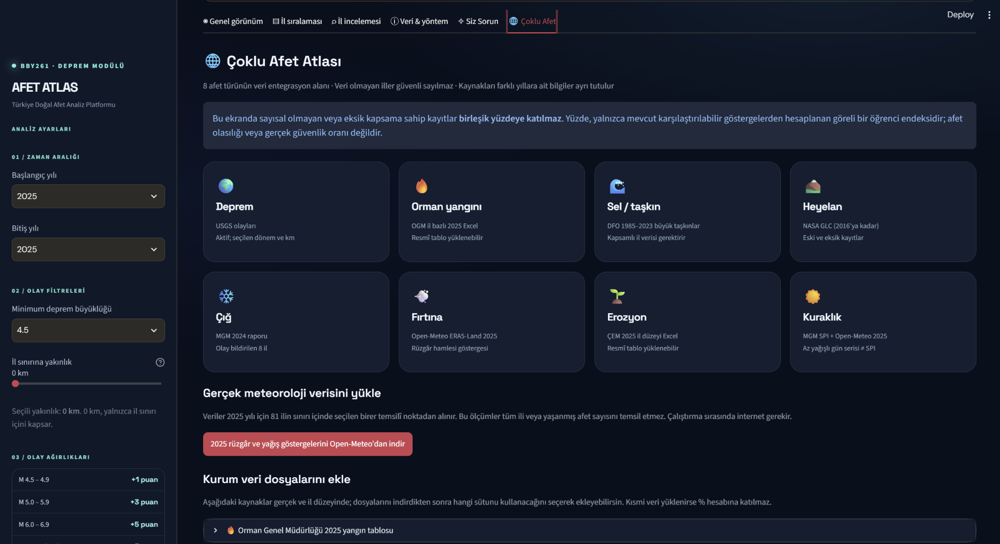

**Sonraki değişiklik:** İlk sekiz kartlı yaklaşım yeniden düzenlendi; **güncel uygulamada yedi afet türü**, aynı Afet Analizi bölümü içinde ayrı harita ve değerlendirme katmanlarıyla sunuluyor. Erozyon güncel yedi afet başlığı arasında yer almıyor.

### 4. Kapsamın genişlemesi — Yaşam ve Ticaret Atlası (v3.2)

Proje yalnızca doğal afetleri açıklamakla kalmayıp **“Nerede yaşanır?”** ve **“Hangi ilçede hangi iş modeli değerlendirilebilir?”** sorularını da ele almaya başladı. İlk yaşam modülünde ilçe nüfusu karşılaştırmaları; ilk ticaret modülünde ise nüfus yoğunluğuna dayalı sektörel ön incelemeler oluşturuldu. Ekranda görülen **“SEGE eşleşmesi henüz doğrulanmadı”** ifadesi, veri entegrasyonunun o sürümde henüz tamamlanmadığını belgeliyor.

<table>
<tr><th>İlk Yaşam Analizi (v3.2)</th><th>İlk Ticari Ön İnceleme (v3.2)</th></tr>
<tr>
<td>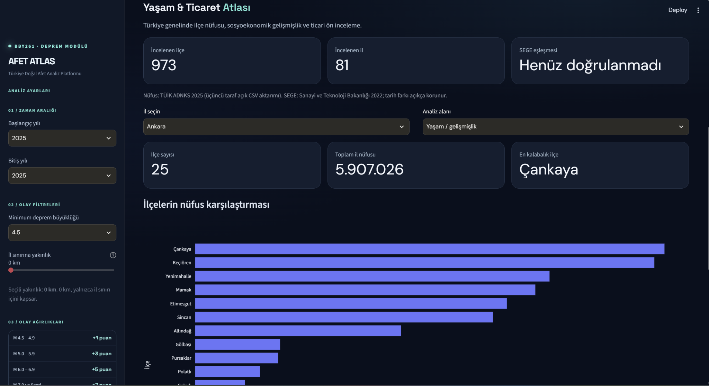</td>
<td>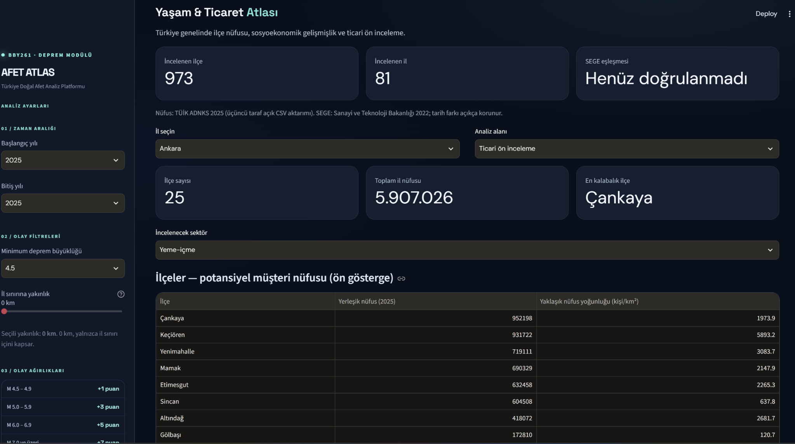</td>
</tr>
</table>

### 5. Ortak harita, ilçe sıralamaları ve “Neden Birinci?” (v3.5)

Modüller ayrı grafiklerden çıkıp **81 il haritası üzerinden yönlendirilen ortak bir arayüzde** buluştu. 2025 nüfus ve **SEGE-2022 verilerini 973 ilçeyle eşleştirme** çalışmaları tamamlandı. Yaşam tercihlerine göre sıralamalar ve ticarette sektöre göre **“Neden Bu İlçe Birinci?”** değerlendirmesi eklendi. Bu dönemde ilk açıklamalar daha çok puan ve sıralama farklarını aktarıyordu.

<table>
<tr><th>Yaşam Kalitesi — harita ve il seçimi</th><th>Ticari Potansiyel — sıralama ve ilk gerekçe</th></tr>
<tr>
<td>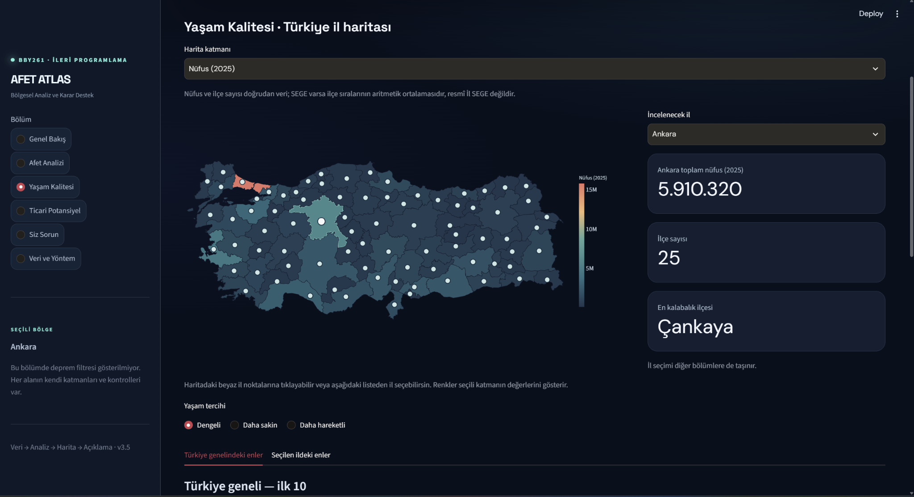</td>
<td>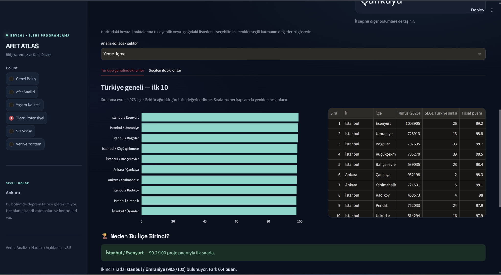</td>
</tr>
</table>

### 6. Afet katmanlarının yeniden yapılandırılması (v3.6)

İlk Çoklu Afet sayfasındaki genel kart ve veri yükleme düzeni yerine **afet türüne özel çalışan analiz ekranları** geliştirildi. Orman yangınları için 2024/2025 yıl seçimi, yangın sayısı/yanan alan göstergeleri, il haritası ve seçilen ilin ayrıntıları aynı bölümde sunuldu. Sel, heyelan, çığ, fırtına ve kuraklık için de kaynakların desteklediği karşılaştırma görünümleri eklendi.

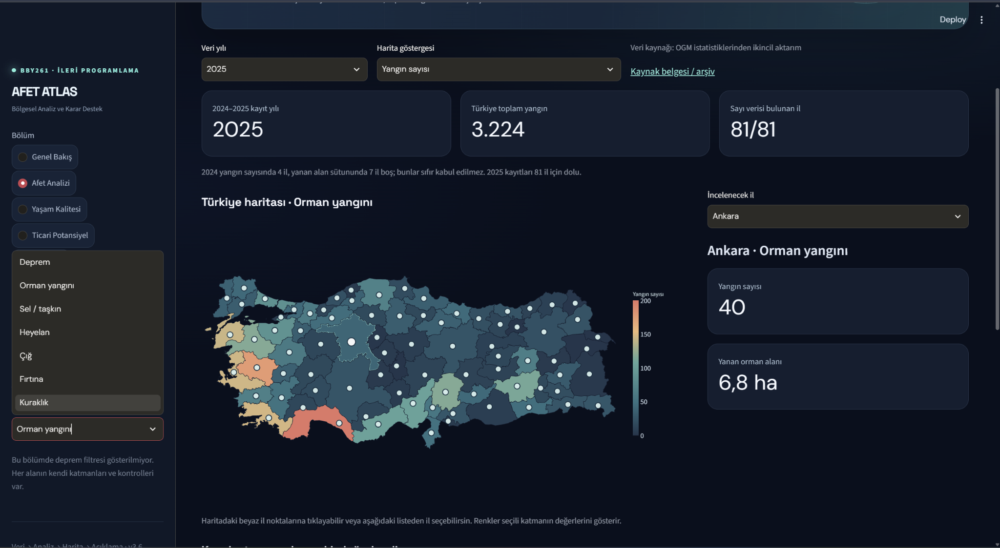

**Geliştirme farkı:** v3.0'da yalnızca listelenen afet konuları, v3.6'da kullanıcıların **haritadan il ve gösterge seçerek inceleyebildiği** ayrı modüllere dönüştü.

### 7. Gerçek işletme ve ulaşım katmanı — OSM entegrasyonu (v3.7–v3.8)

Türkiye OpenStreetMap verilerinden işletme kategorileri ve toplu taşıma noktaları işlenerek **973 ilçelik özet tablo** hazırlandı. Ticari değerlendirmeye sektör bazlı işletme kümelenmesi, nüfusa göre rekabet baskısı ve ulaşım göstergeleri eklendi. Böylece yalnızca nüfus büyüklüğüne dayalı ilk ticaret modelinden daha ayrıntılı bir karşılaştırmaya geçildi.


**Sonraki değişiklik (v3.9):** Sayıları uzun uzun tekrar eden açıklamalar sadeleştirildi; bölgelere göre güçlü ve zayıf yönleri ilişkilendiren yorumlara ve isteğe bağlı sayısal ayrıntılara geçildi.

### 8. Ana sayfanın dönüşümü ve özgün yorumlar (v4.0–v4.2.1)

**Genel Bakış** başlangıçta deprem odaklıydı. v4.0 ile giriş ekranı yeniden tasarlandı: kullanıcı artık **Yaşam ve nüfus**, **Ticari hareketlilik** veya **Doğal afetler** görünümlerini aynı Türkiye haritasında keşfedebiliyor. İlgili ekranın son hâli README'nin en başında gösteriliyor.

v4.1'de Python tabanlı il/ilçe yorumları çeşitlendirildi. v4.2'de ise **Gemini, kullanıcı istediğinde**, Python'un hesapladığı sonuçlar üzerinden daha ayrıntılı bölge açıklamaları üretmeye başladı. v4.2.1'de bağlantı hataları ayrıntılandırılarak model ayarı iyileştirildi. Sıralamaları Python hesaplamaya devam ediyor; Gemini anlatım ve yorum katmanında çalışıyor.

---

## Güncel uygulamadan ekranlar (v4.2.x)

Aşağıdaki ekranlar uygulamanın son sürümünden alınmıştır. Her görsel ayrı bir kullanım senaryosunu gösterir.

### Afet Analizi — Sel / taşkın

Seçilen afet türü için Türkiye haritası, il seçimi ve kaynak temelli karşılaştırma tablosu sunulur. Eski Çoklu Afet kartlarından **etkileşimli afet katmanlarına geçişin** son hâli burada görülür.


### Yaşam Kalitesi — Türkiye genelinde ilçe sıralamaları

Farklı yaşam tercihleriyle 973 ilçenin sıralaması incelenebilir. **“Neden Bu İlçe Birinci?”** alanı birinci ilçeyi diğer adaylarla karşılaştırır; isteyen kullanıcı ayrıca Gemini yorumu oluşturabilir.

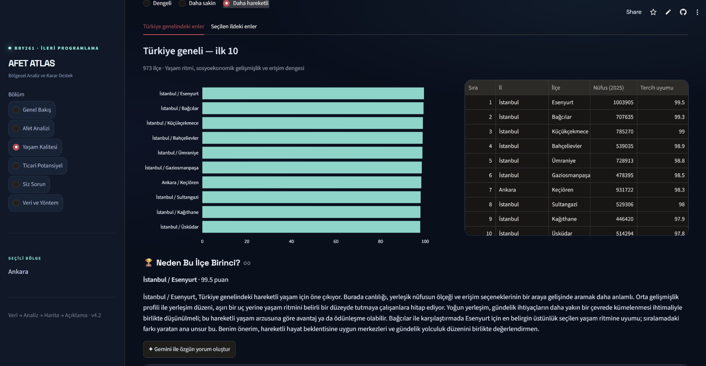

### Ticari Potansiyel — Yorum ve iki ilçe karşılaştırması

Sektöre göre hesaplanan sıralamalar, Python'un bölgesel yorumu, **Gemini'nin bölgeye özel açıklaması** ve iki ilçeyi karşılaştırma alanı aynı sayfada yer alır.

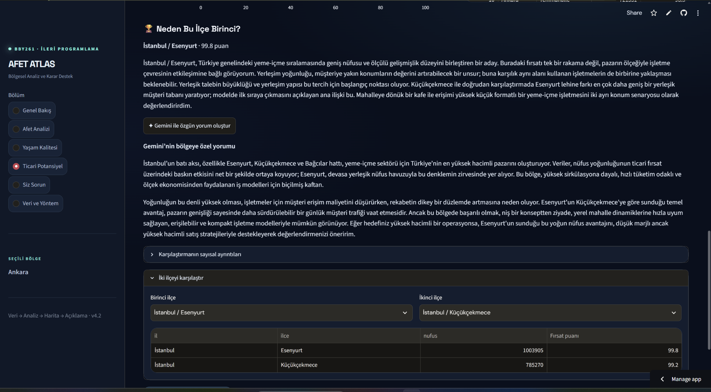

### Siz Sorun — Google ADK destekli soru-cevap

Kullanıcı, hazır sorulardan birini seçebilir veya kendi sorusunu yazarak proje verilerine bağlı bir yanıt isteyebilir. İlk v2.6 ekranına göre daha bütünleşik bir uygulama tasarımına kavuşmuştur.

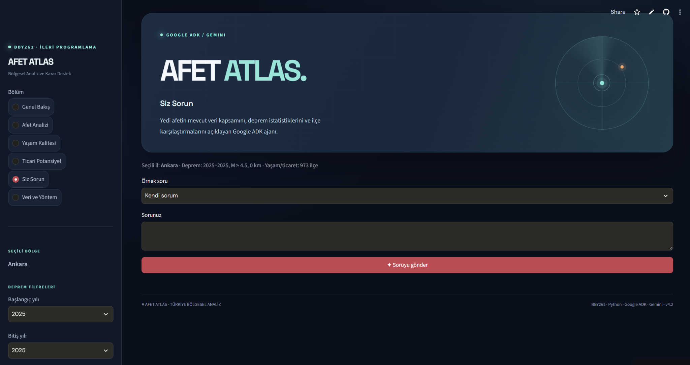

### Veri ve Yöntem — Kaynaklar ve puanlama

Uygulamanın yararlandığı veri kaynakları ve afet, ticaret, yaşam analizi modellerinin temel bileşenleri bu bölümde açıklanır.

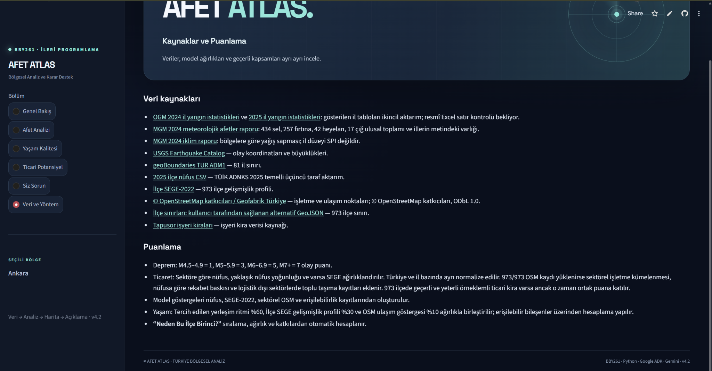

---

## Kullanılan veri kaynakları

| Veri grubu | Kaynak / dönem | Kullanıldığı alan |
|---|---|---|
| Deprem kayıtları | [USGS Earthquake Catalog](https://earthquake.usgs.gov/earthquakes/search/) | Deprem olayları, büyüklük filtreleri, il bazlı karşılaştırma |
| İl sınırları | [geoBoundaries — Türkiye ADM1](https://www.geoboundaries.org/) | 81 il haritası ve coğrafi eşleştirme |
| İlçe nüfusu | TÜİK ADNKS temel alınarak hazırlanmış **2025 ilçe nüfus verisi** | Yaşam, ticaret, ilçe sıralamaları |
| Sosyoekonomik gelişmişlik | **İlçe SEGE-2022**, Sanayi ve Teknoloji Bakanlığı | İlçelerin gelişmişlik profili |
| Orman yangınları | [OGM istatistikleri](https://istatistik.tarimorman.gov.tr/) — 2024/2025 il tablolarının ikincil aktarımı | Yangın sayısı, yanan alan, haritalar |
| Meteorolojik afetler | [Meteoroloji Genel Müdürlüğü](https://www.mgm.gov.tr/) — 2024 afet ve iklim raporları | Sel/taşkın, heyelan, çığ, fırtına, kuraklık katmanları |
| İşletme ve toplu taşıma | [OpenStreetMap / Geofabrik Türkiye](https://download.geofabrik.de/europe/turkey.html) | Ticari kümelenme, sektörel kayıtlar, ulaşım |
| İlçe geometrileri | Projede eşleştirilmiş 973 ilçe sınırı GeoJSON'u | OSM kayıtlarının ilçelere dağıtılması |

**Değerlendirme yöntemi:** Afet katmanları, yaşam tercihi ve ticari potansiyel aynı değişkenlerle puanlanmaz. Yaşam ve ticarette göstergeler kendi modellerinin ağırlıklarıyla karşılaştırılır. OSM kayıtları işletme/ulaşım göstergesi olarak kullanılır; ticari sonuçlar doğrudan ciro tahmini değildir. Afetlerin verisi ve yılı da kendi katmanında korunur. Ayrıntılı açıklamalar **Veri ve Yöntem** ekranında bulunur.

## Teknoloji ve proje yapısı

- **Python + Streamlit:** Web arayüzü, filtreler, veri akışı ve modüller.
- **Pandas:** CSV verilerinin birleştirilmesi, karşılaştırmalar ve sıralamalar.
- **Plotly + coğrafi bileşenler:** Haritalar ve grafikler.
- **Google ADK + Gemini:** Proje araçlarıyla soru-cevap ve isteğe bağlı özgün bölge yorumları.
- **GitHub + Streamlit Community Cloud:** Kaynak kod yönetimi ve canlı yayımlama.

```text
Afet-Atlas/
├── app.py                         # Streamlit giriş noktası
├── genel_bakis.py                # Genel Bakış veri/harita katmanları
├── atlas_afet_ui.py              # Afet analiz ekranları
├── yasam_ticaret_ui.py           # Yaşam ve ticaret ekranları
├── atlas_gemini_yorum.py         # İsteğe bağlı Gemini yorumları
├── atlas_yorum_motoru.py         # Python tabanlı açıklamalar
├── ticaret_veri.py               # Ticari göstergeler
├── ilce_veri.py                  # İlçe verileri ve eşleştirme
├── afet_atlas_adk/               # Google ADK araçları ve ajan
├── indirilen_veriler/            # İşlenmiş veri dosyaları
├── docs/screenshots/            # Proje gelişimi ekran görüntüleri
├── requirements.txt
└── README.md
```

### Yerel çalıştırma

Python kurulu bir ortamda proje klasöründe:

```powershell
python -m pip install -r requirements.txt
python -m streamlit run app.py
```

Gemini yorumlarını yerelde açmak için `.streamlit/secrets.toml` dosyasına kendi Google AI Studio anahtarını ekleyebilirsin:

```toml
GOOGLE_API_KEY = "KENDI_API_ANAHTARIN"
AFET_ATLAS_MODEL = "gemini-3.1-flash-lite"
```

Bu dosya `.gitignore` ile GitHub dışında tutulmalıdır. **Streamlit Community Cloud** üzerinde yayımlanan uygulamada aynı değerler uygulamanın **Secrets** ayarlarına girilir. Anahtar olmadan da Python ile çalışan analiz ekranları kullanılabilir.

### Testler

```powershell
python -m unittest discover -v
```

## Projenin ortaya koyduğu gelişim

Afet Atlas'ın geliştirme süreci üç belirgin dönüşüm içerir:

1. **Deprem kayıtlarının görselleştirilmesi → Çoklu afet analizi:** Tek bir olay türünden yedi ayrı afet katmanına geçildi.
2. **İl haritası → Bölgesel karar desteği:** 81 il haritası, 973 ilçenin yaşam ve ticaret karşılaştırmalarıyla genişletildi.
3. **Sayısal sonuç → Açıklanabilir yorum:** “Neden Bu İlçe Birinci?” karşılaştırmaları Python ile geliştirildi; Gemini, kullanıcı isteğiyle bölgeye özgü yorum üreten ek katman oldu.

Bu README'deki **16 gerçek ekran görüntüsü**, ilk prototipten güncel uygulamaya uzanan bu ilerlemenin belgeleridir.

---

<div align="center">

**AFET ATLAS · BBY261 İleri Programlama**  
*Veriden karşılaştırmaya, karşılaştırmadan yoruma.*

</div>
